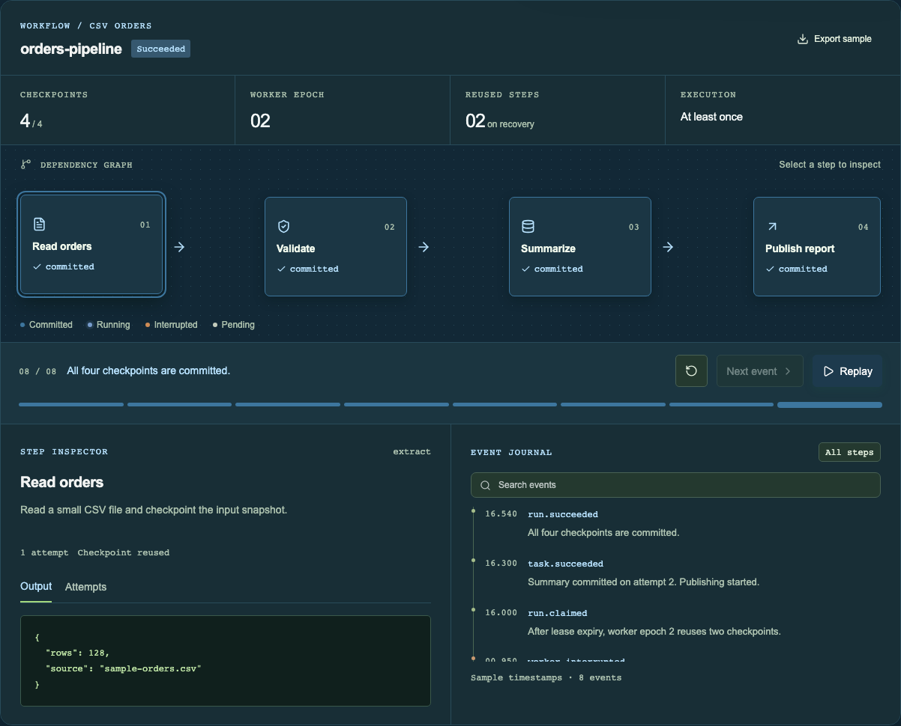
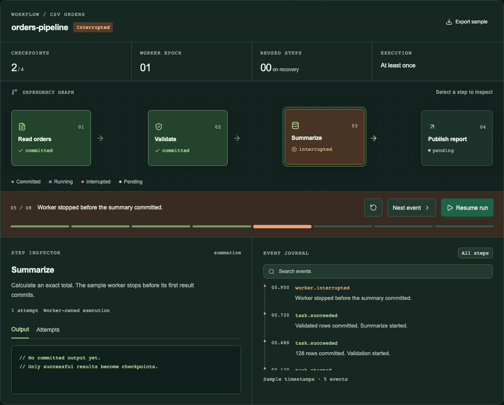
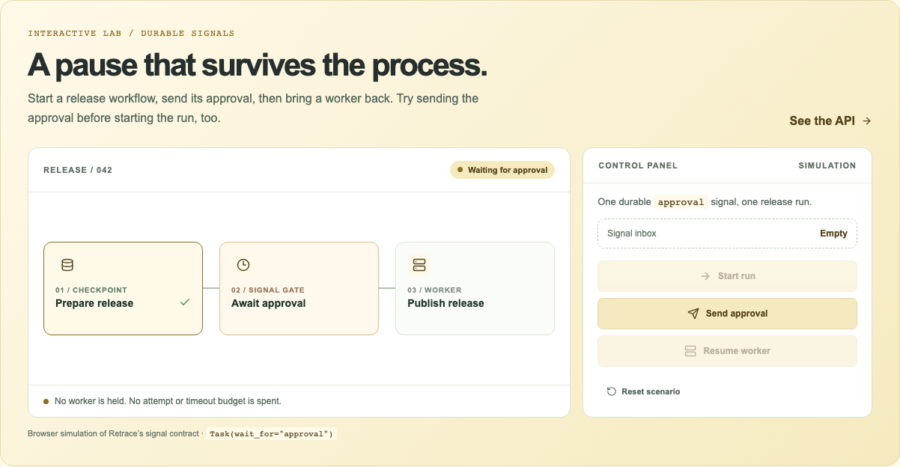
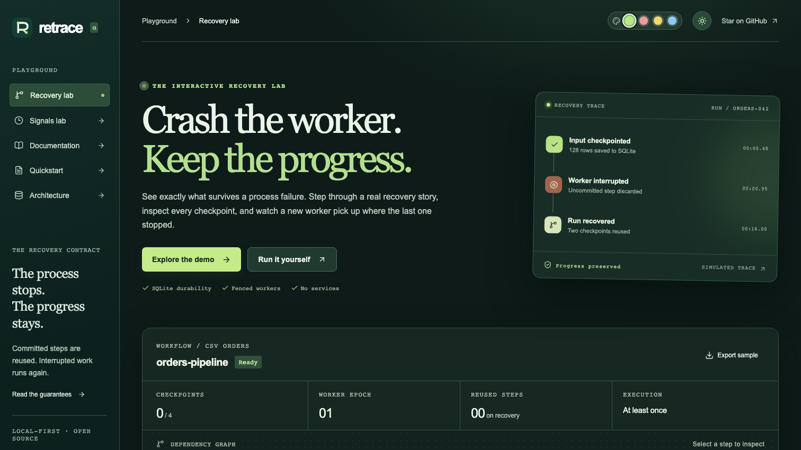
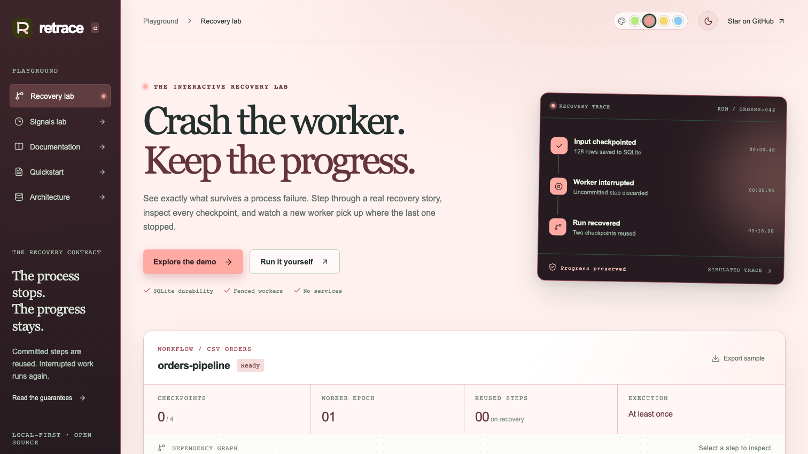
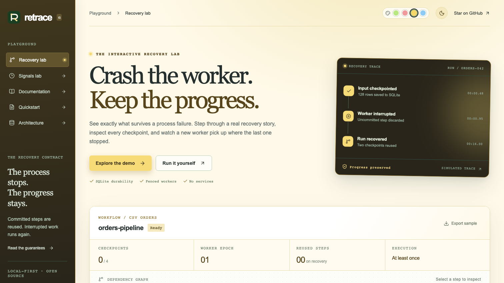
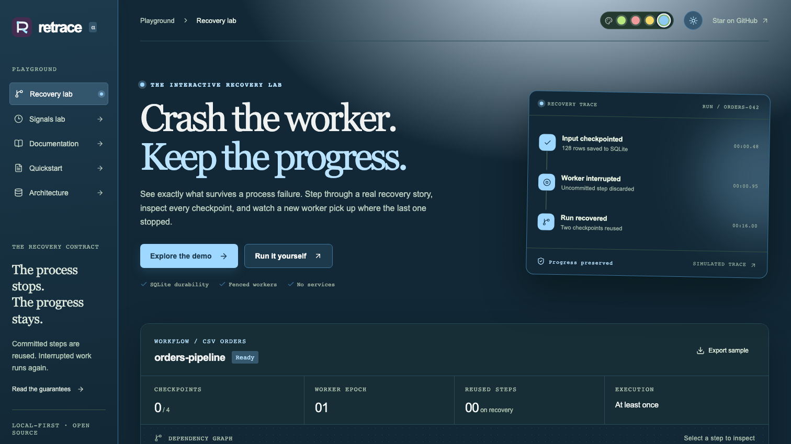

<p align="center"></p>
<h1 align="center">Retrace</h1>
<p align="center"><strong>The process can stop. The progress stays.</strong><br>Crash-resumable Python workflows. One SQLite file. Zero runtime dependencies.</p>
<p align="center">
  <a href="https://github.com/Sanjays2402/retrace/actions/workflows/ci.yml"></a>
  
  
  <a href="LICENSE"></a>
</p>

Retrace is a durable execution engine for async Python. Every completed step is checkpointed to
SQLite as it finishes, so an interrupted workflow resumes from where it stopped instead of
replaying finished work. No brokers, no daemons, no cluster: one local database shared by any
number of worker processes on the machine.

Long-running pipelines die for boring reasons. Containers get OOM-killed, laptops sleep, SSH
sessions drop, a flaky embedding API times out at 3 AM. Retrace treats that as the normal case:
retry transient failures with persisted deadlines, resume crashed workers after their lease
expires, and inspect exactly what completed, what failed, and what is waiting.

**Early alpha:** the API may change before 1.0. Retrace supports a single-machine worker pool
with zero Python runtime dependencies. It is MIT licensed and not yet published to PyPI.

<p align="center">
  <a href="https://sanjays2402.github.io/retrace/">Try the interactive demo</a> ·
  <a href="https://sanjays2402.github.io/retrace/docs/">Read the documentation</a> ·
  <a href="https://sanjays2402.github.io/retrace/docs/choosing-retrace/">Is Retrace a fit?</a>
</p>

[](https://sanjays2402.github.io/retrace/)

**[Try the recovery playground →](https://sanjays2402.github.io/retrace/)** · [Install locally](#quickstart)

## Features

- **Durable checkpoints.** Each step's output is committed to SQLite before the next step runs.
  Resume reuses them; completed steps are never replayed.
- **DAG pipelines in plain Python.** Async task functions, declared dependencies, cycle
  detection, topological execution.
- **Retries that survive crashes.** Backoff deadlines and attempt history are persisted, so a
  retry schedule continues after the process dies. Mark errors non-retryable to fail fast.
- **Crash recovery by lease.** Workers hold a heartbeat lease on their runs. A dead worker's
  lease expires and another worker picks the run up; stale workers are fenced and cannot
  commit after ownership moves.
- **Durable signals.** Tasks can wait for an external decision without holding a worker;
  `retrace signal` delivers a one-shot payload that wakes them.
- **Local multi-process queue.** Any number of workers share one database file, claim runs
  atomically, and drain gracefully on SIGTERM. Idempotent submission keys deduplicate
  retries, and delayed dispatch schedules work for later.
- **Versioned definitions.** A workflow fingerprint prevents changed code from reusing stale
  checkpoints. Bump `Workflow.version` when behavior changes.
- **Read-only inspector.** Dependency graph, attempt timeline, worker epochs, checkpoint
  outputs, and a searchable event journal on loopback, with no mutation routes.
- **Operational visibility.** Failure rates, p50/p95 latency, recovered runs, and expired
  leases over 24h/7d/30d, threshold checks with scriptable exit codes, and Prometheus gauges
  for queue depth and wait age.
- **Safe maintenance.** Checked database backups, retention previews that protect unfinished
  work, and diagnostic reports and Perfetto traces for postmortems.

## Quickstart

Requires **Python 3.11+**:

```bash
git clone https://github.com/Sanjays2402/retrace.git
cd retrace
python3 -m venv .venv
source .venv/bin/activate              # Windows: .venv\Scripts\activate
python -m pip install -e .
retrace demo
retrace serve
```

Open **http://127.0.0.1:7760**. In another activated terminal, run `retrace demo` again to watch
new runs appear. The demo is an eight-step document-indexing simulation: its first embedding
attempt fails against a simulated rate limit, then retries and commits 512 vectors. No external
API calls; checkpoints and history persist to a real SQLite database.

### Watch a crash recover

```bash
retrace --lease-ttl 1.5 demo --crash
# Hard-exits with code 86 mid-embedding. Copy the printed run ID.
# Wait two seconds for the dead worker's lease to expire, then:
retrace resume retrace.demo:workflow <RUN_ID>
retrace inspect <RUN_ID>
```

Everything before the crash is reused. The interrupted attempt stays in the timeline, and the
run finishes. Follow the
[five-minute recovery walkthrough](https://sanjays2402.github.io/retrace/docs/getting-started/)
for the full sequence.

## Define a workflow in ordinary Python

Save this as `pipeline.py`:

```python
from retrace import Context, RetryPolicy, Task, Workflow


async def extract(ctx: Context):
    return ctx.input["values"]


async def fetch_price(ctx: Context):
    # Flaky upstream: retries with backoff, deadline persisted across crashes.
    return await call_exchange_api(ctx)


async def summarize(ctx: Context):
    prices = ctx.dependencies["fetch_price"]
    return {"count": len(prices), "total": sum(prices)}


workflow = Workflow(
    "analytics",
    (
        Task("extract", extract),
        Task("fetch_price", fetch_price, needs=("extract",),
             retry=RetryPolicy(max_attempts=5, initial_delay=1.0, max_delay=60.0)),
        Task("summarize", summarize, needs=("fetch_price",)),
    ),
    version="1",
)
```

```bash
retrace run pipeline:workflow --input '{"values": [3, 7, 11]}'
```

Kill the process mid-run with `kill -9` if you like. `retrace resume pipeline:workflow <RUN_ID>`
picks it up where it stopped. A `wait_for="decision"` task pauses for a human without holding a
worker; `retrace signal <RUN_ID> decision --payload '{"approved": true}'` wakes it. See the
[Python API guide](https://sanjays2402.github.io/retrace/docs/api/) and
[runnable examples](https://sanjays2402.github.io/retrace/docs/examples/) for CSV, HTTP, retry,
approval, and recovery patterns. You can also embed `Engine` and `Store` directly in your
application.

## Queue work across local processes

```bash
retrace --db jobs.db submit examples.pipeline:workflow \
  --input '{"values":[3,7,11]}' --key batch-42
retrace --db jobs.db queue --configure examples.pipeline:workflow \
  --max-active 2 --max-queued 100
retrace --db jobs.db worker examples.pipeline:workflow --max-runs 2
# Start another worker in a second terminal against the same local database.
```

Submission keys deduplicate identical requests, even after completion. `--delay 60` schedules
durable delayed dispatch; `worker --once` drains available work and exits. Workers load multiple
definitions with fair round-robin scheduling, and SIGTERM drains active work for a configurable
grace period before pausing unfinished runs for handoff. The inspector's **Queue overview**
shows backlog, capacity limits, signal waits, and expired leases ready for recovery. See
[worker and queue semantics](https://sanjays2402.github.io/retrace/docs/api/).

## Investigate a run

The read-only local inspector combines a dependency graph, attempt timeline, worker epochs,
checkpoint outputs, and a searchable event journal. Expand the live list up to 1,000 runs,
filter for work needing attention, or save a permalink to a selected run and step.

```bash
retrace --db jobs.db runs --status failed --status waiting
retrace --db jobs.db runs --workflow analytics --limit 25
retrace --db jobs.db report <RUN_ID> > run.report.json
retrace --db jobs.db trace <RUN_ID> > run.trace.json
retrace --db jobs.db events <RUN_ID> > events.jsonl
```

**Download report** captures checkpoint metadata, attempt history, signal names, and recent
events in one snapshot. Inputs, outputs, payloads, and exception messages are omitted by
default; names and identifiers stay visible, so review before sharing. Payloads need an explicit
`report --include-payloads` opt-in. **Download trace** exports attempts for
[Perfetto](https://ui.perfetto.dev), one lane per task. See
[diagnostic reports](https://sanjays2402.github.io/retrace/docs/api/).

## Measure reliability and check thresholds

The **Workflow health** panel compares definitions over 24 hours, 7 days, or 30 days: failed
runs as a fraction of finished runs, p50/p95 completion latency, interrupted attempts, runs
that recovered after failure, and expired leases.

```bash
retrace --db jobs.db health --hours 168 > weekly-health.json
retrace --db jobs.db health --hours 168 \
  --max-failure-rate 0.05 --max-p95-seconds 60 \
  --max-expired-leases 0 --min-completed 20 > health-check.json
```

Checks exit `0` for pass, `1` for a known breach, `2` for invalid options or infrastructure
errors, `3` for insufficient data. Empty or truncated cohorts cannot silently pass; a fresh
demo database legitimately returns `3`. These are operational measurements, not an SLA
guarantee. Read the [metric definitions](https://sanjays2402.github.io/retrace/docs/api/) and
the threshold guide.

For live dashboards, scrape `http://127.0.0.1:7760/metrics` while the inspector runs, or
snapshot with `retrace --db jobs.db metrics > queue.prom`. The gauges are read-only and omit
application payloads and run IDs.

## Recovery and maintenance

| Operation | Command | Behavior |
| --- | --- | --- |
| Wait for a decision | `Task(..., wait_for="decision")` and `retrace signal RUN_ID decision --payload '{"approved":true}'` | Durable one-shot signal; waiting releases the worker lease |
| Preview a failed-branch retry | `retrace retry pipeline:workflow RUN_ID --task summarize --dry-run` | Shows affected steps without resetting checkpoints |
| Retry a failed branch | `retrace retry pipeline:workflow RUN_ID --task summarize` | Preserves successful steps and attempt history |
| Resume an interrupted run | `retrace resume pipeline:workflow RUN_ID` | Reuses checkpoints; never replays completed steps |
| Cancel work | `retrace cancel RUN_ID` | Revokes ownership; completed checkpoints remain |
| Back up live data | `retrace backup backups/snapshot.db` | Checked standalone snapshot including committed WAL data; never overwrites a destination |
| Preview cleanup | `retrace prune --older-than 30` | Protects unfinished work and submission keys; deletion requires `--apply` |

Commands use `retrace.db` by default; put `--db jobs.db` **before** the subcommand to select
another database. Create the backup directory first. `resume` continues interrupted work;
`retry` explicitly resets failed steps after the external cause is fixed. Read
[durable signals](https://sanjays2402.github.io/retrace/docs/api/),
[recovery](https://sanjays2402.github.io/retrace/docs/recovery/), and
[backup and retention](https://sanjays2402.github.io/retrace/docs/api/).

## Guarantees and boundaries

- **Execution is at least once.** A crash can land after an external request succeeds but
  before its checkpoint commits. Use `ctx.idempotency_key` with downstream systems that
  support deduplication; fencing protects the database, not external side effects.
- **Single machine, local disk.** Multiple local processes can claim separate runs from one
  database. Multi-host scheduling, network filesystems, and multi-tenant hosting are out of
  scope.
- **Completed outputs are immutable checkpoints.** Successful functions are not replayed on
  resume. Fingerprints block changed definitions from reusing old checkpoints, but they do
  not hash function source or installed dependencies, so bump `Workflow.version` when
  behavior changes.
- **Tasks must cooperate with asyncio.** Blocking work delays heartbeats; timeouts and
  cancellation cannot stop code that suppresses cancellation.
- **Small JSON payloads.** Inputs and outputs are capped at 1 MiB each; keep large artifacts
  outside the database. Writable opens migrate supported older schemas; back up first.
- **Local inspection only.** The inspector binds to loopback and rejects foreign Host/Origin
  headers. It has no mutation routes but displays stored application data, so avoid
  persisting secrets.

See [architecture and failure semantics](https://sanjays2402.github.io/retrace/docs/architecture/)
and [security guidance](https://sanjays2402.github.io/retrace/docs/security/).

## Explore the browser demo

The [public recovery playground](https://sanjays2402.github.io/retrace/) needs no account or
install. It demonstrates checkpoint reuse, worker crashes, signal gates, journal search, and
theme switching on **synthetic browser data**; the Python engine and local inspector persist
actual runs to SQLite.

| Worker interrupted · green | Run recovered · blue |
| :---: | :---: |
| [](docs/assets/feature-interrupted.png) | [](docs/assets/feature-recovered.png) |

<details>
<summary>More screenshots: signal gates and four color themes</summary>

[](docs/assets/feature-signal-wait.png)

| Green · dark | Red · light |
| :---: | :---: |
| [](docs/assets/theme-green.png) | [](docs/assets/theme-red.png) |
| Yellow · light | Blue · dark |
| :---: | :---: |
| [](docs/assets/theme-yellow.png) | [](docs/assets/theme-blue.png) |

</details>

[Playground source and development guide](playground).

## Development and validation

```bash
python -m pip install -e '.[dev]'
ruff check .
ruff format --check .
python -m coverage run -m unittest discover -s tests
python -m coverage report --fail-under=95
python -m build
python scripts/smoke_wheel.py
```

For the inspector browser suite:

```bash
npm ci --ignore-scripts
npx playwright install chromium
npm run check:ui
npm run test:ui
```

CI enforces a 95% coverage floor and tests Python 3.11–3.14 on Linux, plus Python 3.12 on
macOS and Windows. Tests cover process crashes, producer/worker contention, generated DAGs,
stale-worker fencing, rollback, persistent retry deadlines, retention, exports, health checks,
and browser interactions. Packaging CI installs the wheel in a clean environment outside the
source tree. The
[reproducible benchmark](https://sanjays2402.github.io/retrace/docs/benchmark/) records
scheduler and checkpoint overhead, including its measurement limits.

## Contribute

Read [CONTRIBUTING.md](CONTRIBUTING.md). Contributions that improve verified recovery
semantics, operational visibility, or a concrete workflow limitation are welcome. Include a
minimal workflow and a diagnostic report with sensitive identifiers reviewed when reporting
a bug. Full payload reports should not be shared without reviewing their contents.

MIT licensed.

## Terms & Disclaimer

By using this project you agree to the following.

- **No warranty.** This software is provided "as is", without warranty of any kind, express or implied, including merchantability, fitness for a particular purpose, and non-infringement.
- **No liability.** To the maximum extent permitted by law, the author and contributors are not liable for any claim, loss, or damage (direct, indirect, incidental, or consequential, including lost data or profits) arising from its use.
- **Your responsibility.** You use it at your own risk and are responsible for complying with the laws that apply to you.
- **Your data.** Keep backups; data loss is possible. If you process other people's personal information, you are responsible for complying with privacy laws such as US state privacy laws (e.g. CCPA), PIPEDA and Quebec's Law 25 (Canada), and the Digital Personal Data Protection Act, 2023 (India).
- **Third parties.** Names, logos, APIs, and services of others belong to their owners and are used for identification only; no affiliation or endorsement is implied.
- **Your statutory rights.** Nothing here limits rights that cannot be waived by agreement, including under consumer-protection laws in the USA, Canada (including Quebec), and India (Consumer Protection Act, 2019).
- **License.** Use, copying, and distribution are governed by the [LICENSE](LICENSE) file; if anything here conflicts with it, the license controls.

## Content, Assets & Fair Use

- **Original work.** Unless noted otherwise (including below), the code, text, design, and images in this repository were created by the author.
- **Libraries, fonts, and icons.** Third-party libraries, fonts (for example Google Fonts), and icon sets belong to their creators and are used under their own licenses; see the dependency manifests and each source for terms.
- **Logos, brands, and screenshots.** Third-party names, logos, and screenshots appear only to identify or describe their products (nominative use). They remain the property of their owners and do not imply affiliation or endorsement.
- **Ideas and inspiration.** Where this project is inspired by another product, game, or idea, it is an independent implementation. It borrows only general ideas, mechanics, or styles, which are not anyone's exclusive property, and is meant to contain no third-party code or artwork used without permission.
- **Fair use and fair dealing.** Any third-party material is used in limited ways for purposes such as education, research, review, commentary, or identification, relying on fair use in the USA (17 U.S.C. § 107), fair dealing in Canada (Copyright Act, ss. 29–29.2), and fair dealing in India (Copyright Act, 1957, s. 52), where they apply.
- **Concerns and takedown requests.** If you own rights in something here and believe it is used improperly, [open an issue](https://github.com/Sanjays2402/retrace/issues) or contact the author through their GitHub profile with a link to the material and your claim. It will be reviewed promptly and credited, changed, or removed as appropriate. You may also use GitHub's DMCA process.
- **Contributions.** By contributing, you confirm you have the right to submit your contribution and agree it is licensed under this repository's license.
- **Website.** The project site has its own [Terms](https://sanjays2402.github.io/retrace/terms.html) and [Fair Use](https://sanjays2402.github.io/retrace/fair-use.html) pages.
